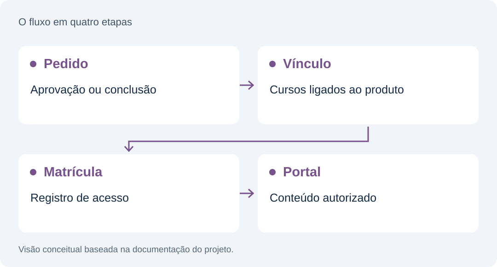

<picture>
  <source media="(max-width: 640px)" srcset="assets/cover-mobile.svg">
  
</picture>

**Implantação & controle de acesso** · Estudo de caso · Código-fonte privado

Implantação e adaptação de uma plataforma baseada no Hubfy Lite, com banco próprio, regras de acesso e funções para integrar a operação.

## O problema

Entregar conteúdo exige alinhar produto, pedido, matrícula e permissão. Ter uma interface de cursos não basta quando a operação depende de acesso correto, e-mail e serviços externos.

## A solução

O repositório documenta a configuração de uma instância própria, aplicação de migrations, publicação de funções e deploy contínuo. O acesso aos cursos é materializado no banco a partir do estado do pedido e verificado por políticas de acesso.

## Como o sistema se organiza

<picture>
  <source media="(max-width: 640px)" srcset="assets/architecture-mobile.svg">
  
</picture>

## Decisões que merecem uma conversa técnica

### Uma origem clara para o acesso

A documentação descreve a cadeia pedido → cursos do produto → matrícula. Cancelamentos e reembolsos revogam o acesso pelo mesmo mecanismo.

### Permissão no banco

As políticas de Row Level Security decidem quais registros cada pessoa pode acessar. Funções executam operações que exigem segredo ou privilégio.

### Adaptação de uma base existente

O escopo inclui provisionamento, configuração e evolução de uma instância baseada no Hubfy Lite. A base original é explicitamente creditada.

## Tecnologias no escopo do case

React · TypeScript · Supabase · PostgreSQL / RLS · Deno

## Roteiro para uma demonstração técnica

1. Usar um pedido de teste para demonstrar liberação e revogação de acesso.
2. Mostrar o portal com duas contas e permissões diferentes.
3. Apresentar uma adaptação própria e explicar a diferença em relação à base original.

## Escopo e limites

Projeto derivado do Hubfy Lite, sob a licença indicada no repositório de origem. O case apresenta implantação e adaptação, sem atribuir a criação da plataforma-base ao autor do portfólio. O estado atual das integrações precisa ser confirmado: o README e commits recentes divergem em alguns pontos.

## Sobre este repositório

Este repositório reúne a apresentação do projeto. O código-fonte da aplicação permanece privado. Os diagramas são conceituais; não são capturas do produto.

[Portfólio de Cristian Michelin](https://github.com/damomebr)
